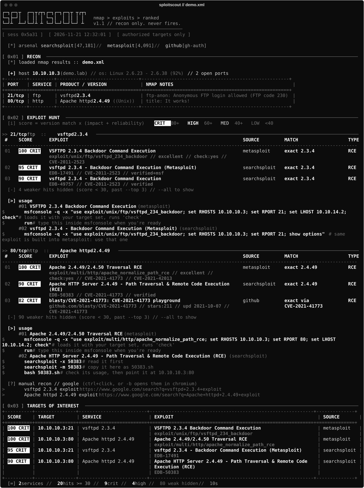

# sploitscout

**nmap > exploits > ranked.** Point it at an IP. It runs nmap, takes every service version it finds, and searches
**searchsploit (Exploit-DB)**, **Metasploit** and **GitHub PoCs** for exploits. Each result gets a score from 0 to
100, its exact name and where it was found, plus copy-paste commands to use it.

It automates the boring part of recon, where you'd otherwise search every service by hand. **It never runs an exploit.**
The output is plain black and white: `[*] [+] [!]` status tags, ASCII tables, and critical hits in reverse video.
On narrow terminals the tables switch to a compact layout.



> **[!]** Only scan systems you own or are explicitly authorized to test.

## Why

You see `vsftpd 5.12.5` in nmap and search for it, but the exploit is filed as `vsftpd 5.12.x`, `< 5.13` or
`5.12.0 - 5.12.9`, and you miss it. sploitscout searches by product name, then reads the version ranges in each
exploit's title or description and checks whether **your** version falls inside them:

| Exploit says | Your version `5.12.5` | Weight |
|---|---|---|
| `5.12.5` | exact | 1.00 |
| `< 5.13`, `5.12.0 < 5.12.9`, `5.12.6 and earlier` | in range | 0.95 |
| `5.12.x`, `5.12` | same minor family | 0.85 |
| `5.12.3` | close version | 0.60 |
| `5.x` | same major | 0.50 |
| *(no version listed)* | product only | 0.30 |
| `< 5.10`, `4.2.1` | **not affected → hidden** | |

It also handles `7.4p1` (OpenSSH), `3.0.25rc3`, `1.0.1f` (OpenSSL), shorthand like `1.3.29-36`, and phrases such as
`versions before 2.3.3` or `up to 2.4.50`.

## Score

```
score = version match × (impact + reliability)        0 – 100
```

- **Impact**, from the title and description: RCE 50 · file upload 45 · overflow 42 · auth bypass 38 · privesc 36 ·
  traversal/LFI and SQLi 32 · info leak 18 · XSS 14 · DoS 8. Local-only exploits get a small penalty.
- **Reliability:** Metasploit rank (excellent 50 … manual 16), Exploit-DB verified 40 / unverified 30, GitHub by stars.
- **Extras:** an exploit for the wrong OS (Windows-only on a Linux box) is scored ×0.6. An entry with no version
  borrows the match of another entry with the same CVE.

`CRIT 80+ · HIGH 60+ · MED 40+ · LOW <40`. Treat the scores as "look here first", not as proof: nmap's
version detection can be wrong.

## Install (Arch Linux)

```bash
sudo pacman -S nmap python-rich metasploit github-cli
yay -S exploitdb                      # searchsploit + the Exploit-DB archive
git clone https://github.com/harelhz/sploitscout && cd sploitscout
sudo install -m755 sploitscout /usr/local/bin/sploitscout
gh auth login                         # optional: faster GitHub PoC search
```

Kali and Parrot already ship nmap, searchsploit and Metasploit, so there you only need `python3-rich`. Any source
that isn't installed is skipped with a warning.

## Usage

```bash
sploitscout 10.10.10.5                 # sudo nmap -A -T4 -p- 10.10.10.5, then hunt exploits
sploitscout 10.10.10.5 --fast          # open ports first, then -A only on them (much faster)
sploitscout 10.10.10.5 -r              # also save an HTML report
sploitscout 10.10.10.5 -b              # also open a Google search per service in Chromium
sploitscout -x scan.xml                # use an nmap XML you already have (nmap -oX scan.xml …)
sploitscout -s "ProFTPD 1.3.5"         # look up one product + version, no scan
sploitscout -x examples/sample_scan.xml --no-web   # try it offline on the bundled sample
```

| Option | What it does |
|---|---|
| `--fast` | find open ports first, then run `-A` only on them |
| `--pn` | skip host discovery (`-Pn`), for hosts that block ping |
| `--no-web` | offline: skip the GitHub PoC search |
| `--no-msf` / `--no-edb` | skip Metasploit / searchsploit |
| `-b, --browser` | open Google searches for every service in Chromium (or your browser) |
| `--min-score N` | hide results below N (default 30) |
| `--top N` | max results per service (default 8) |
| `--all` | show everything |
| `--howto N` | usage commands for the top N per service (default 3) |
| `--lhost IP` | your IP for Metasploit `LHOST` (auto-detected from the route to the target) |
| `-r [FILE]` | save a report: `.html` (default), `.md`, `.json` or `.svg` |
| `-o DIR` | where scan files go (default `./sploitscout_<target>_<time>/`) |

Every scan saves `nmap.txt`, `nmap.xml` and `results.json` in its results folder.

## What you get per service

- A ranked table: score · exact exploit name · **found in** (metasploit / searchsploit / github) · why the version
  matches · type (RCE, LFI, …), with the EDB ID, module path, CVEs and GitHub stars.
- **How to use** for the top hits, with your target already filled in:
  - Metasploit: `msfconsole -q -x "use …; set RHOSTS …; set RPORT …; set LHOST …; check"`. It loads the module and
    runs `check` only. You type `run` yourself.
  - searchsploit: `searchsploit -x ID` (read), `searchsploit -m ID` (copy), and how to run it (`python3`, `gcc`, …).
    For old EDB copies of Metasploit modules, it points you to the built-in module instead.
  - GitHub: `git clone …`, plus a reminder to read the code first. **Fake PoCs that contain malware exist.**
- Extra versions it finds itself: PHP and OpenSSL from the HTTP `Server` header, the CMS from `http-generator`, the
  real Samba version from `smb-os-discovery`.

## How the sources work

| Source | How |
|---|---|
| searchsploit | reads Exploit-DB's local `files_exploits.csv` directly (fast, offline) |
| Metasploit | reads Metasploit's module metadata JSON directly. No msfconsole startup, so it's instant |
| GitHub | official search API through your `gh` login (30 searches/min; without login 10/min, so it's slower). Searches the CVEs already matched plus "product version exploit" |
| Google | sploitscout doesn't scrape Google (Google blocks bots and its official search API is closing). It prints Google search links per service, and `-b` opens them in Chromium for you |

## Tests

```bash
python3 tests/test_versions.py        # or: pytest
```

## License

MIT. Use it responsibly and legally.
